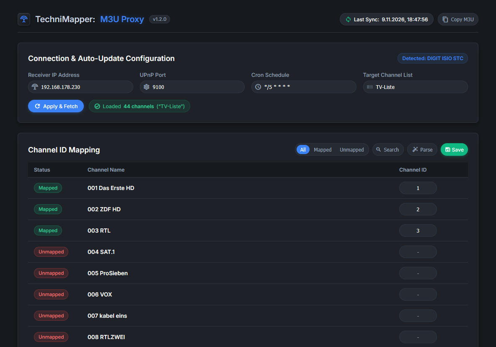
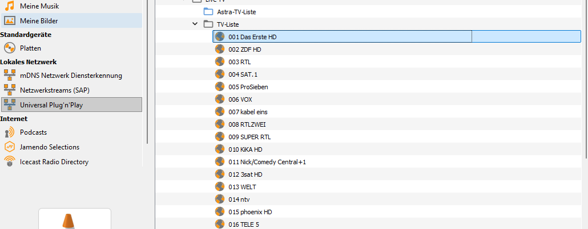

# TechniMapper: HDHomeRun Tuner Emulation for TechniSat Receivers
Turns the live TV channel list of a TechniSat receiver into a stable **HDHomeRun network tuner** for **Plex** and **Jellyfin**. The same channels are also available as an optional M3U8 playlist.

## The Problem: Stream Instability
TechniSat receivers frequently change internal stream URLs and session parameters due to channel rescans, background updates, or reboots. Linking these raw URLs directly into a media center causes constant breakage, as the streams become dead ends as soon as the receiver refreshes its internal state.

## The Solution: TechniMapper
TechniMapper acts as an abstraction layer to ensure your configuration remains stable:

* **HDHomeRun Emulation:** Plex and Jellyfin use TechniMapper directly as a network tuner below `/hdhr`, no M3U8 file needed (see [below](#hdhomerun-emulation-plex--jellyfin)). The tuner name is built automatically from the detected receiver, e.g. `TechniSat DIGIT ISIO STC`.
* **Dynamic Synchronization:** A background cron engine crawls the receiver’s shifting UPnP structure to fetch the latest, valid stream URLs.
* **Static Mapping:** Maps volatile URLs to permanent, custom Channel IDs defined via the Web UI. The ID becomes the channel number.
* **Automated List Fetching:** Selecting a different target channel list automatically triggers an immediate *Apply & Fetch* cycle.
* **Smart Parsing:** One-click extraction automatically parses channel numbers from channel names.
* **Safe by Default:** If the receiver is unreachable (e.g. in standby), the **last known channel list** keeps being served. Strict input validation, optional Basic Auth, health endpoint, non-root container, signed multi-arch images.
* **Optional M3U8 Playlist:** The same mapped channels are available at `/playlist.m3u8` for players such as VLC (see [below](#optional-m3u8-playlist)).

## Compatibility Note
TechniMapper is specifically developed and tested for the TechniSat DIGIT ISIO STC.

✅ **Supported:** DIGIT ISIO S / S1 / S2, DIGIT ISIO STC

❌ **Not Supported:** DIGIPLUS UHD S2, DIGIT ISIO S3, and newer

*Note: Models not listed as supported may use different SOAP service structures which are not currently implemented.*



## Prerequisites

⚠️ **Crucial Step:** Before running this tool, you **must have a valid, fully configured TV channel list** set up directly on your receiver (specifically tested on the *TechniSat DIGIT ISIO STC*). If no internal channel list exists on the hardware, the UPnP directory tree will remain empty, and the mapper won't be able to discover any streams.

The receiver must be reachable from the container via a **private IPv4 address** (10.x, 172.16–31.x, 192.168.x). For VPN/CGNAT setups set `ALLOW_NON_PRIVATE_IP=true`.



## Quick Start & Deployment

The container runs as the unprivileged user `node` (**UID 1000**). The examples below store `/app/data` in a **named volume**; Docker gives it the correct permissions automatically, so no setup is needed.

If you prefer a **bind mount** (e.g. `./data:/app/data`), the directory must be writable for that user. Otherwise the container restarts in a loop (Portainer shows no IP and no ports) and the log says *"Data directory ... is not writable"*:

```bash
mkdir -p data && chown -R 1000:1000 data
```

### Which port?
TechniMapper listens on port **9191** by default (`PORT`), and the examples publish it unchanged (`9191:9191`). The Web UI and all endpoints are then reachable at `http://<YOUR-SERVER-IP>:9191`. Enter the port you publish in Plex and Jellyfin. If you change `PORT`, change the port mapping and the address in your media center accordingly.

### Option A: Docker Compose (Recommended)

```yaml
services:
  technimapper-m3u-proxy:
    image: ghcr.io/danielfranze/technimapper-m3u-proxy:latest
    container_name: technimapper-m3u-proxy
    ports:
      - "9191:9191"
    volumes:
      - technimapper-data:/app/data
      - /etc/localtime:/etc/localtime:ro
    environment:
      - TZ=Europe/Berlin
      # - HDHR_FRIENDLY_NAME=Living Room
      # - ADMIN_USER=admin
      # - ADMIN_PASSWORD=change-me
    read_only: true
    tmpfs:
      - /tmp
    cap_drop:
      - ALL
    security_opt:
      - no-new-privileges:true
    restart: unless-stopped

volumes:
  technimapper-data:
```

`latest` always points to the newest stable release (pre-releases such as `1.8.0-rc.1` never move `latest`, `1` or `1.7`; use their exact tag to test them). If you need reproducible deployments, pin a version tag instead, e.g. `ghcr.io/danielfranze/technimapper-m3u-proxy:1.7.0`.

The repository also ships a ready-to-use `docker-compose.yml` (builds locally with `build: .`).

### Option B: Portainer Stack
1. Open your **Portainer** dashboard → **Stacks** → **Add stack**.
2. Give it a name (e.g., `technimapper-m3u-proxy`).
3. Select the **Web editor** and paste the Compose snippet from Option A.
4. The snippet uses a **named volume** (`technimapper-data:/app/data`), which works in Portainer without any permission setup. Avoid relative bind mounts such as `./data` there: Docker creates them as `root` and the container cannot write to them. If you want a bind mount, use an **absolute host path** and run `chown -R 1000:1000 <path>` once.

### Option C: Docker CLI
```bash
docker run -d \
  -p 9191:9191 \
  --name technimapper-m3u-proxy \
  -v technimapper-data:/app/data \
  -v /etc/localtime:/etc/localtime:ro \
  -e TZ=Europe/Berlin \
  --restart unless-stopped \
  ghcr.io/danielfranze/technimapper-m3u-proxy:latest
```

### Updating to a new release
Your settings and mapping live in the volume and survive updates.

* **Portainer:** *Stacks* → your stack → **Update the stack** with **Re-pull image** enabled.
* **Docker Compose:** `docker compose pull && docker compose up -d`
* **Docker CLI:** `docker pull ghcr.io/danielfranze/technimapper-m3u-proxy:latest`, then remove the container (`docker rm -f technimapper-m3u-proxy`) and run the command from Option C again.

Check the [CHANGELOG](CHANGELOG.md) for breaking changes before you update.

### Upgrading from 1.6.x or older: new default port
The server now listens on port **9191** by default (it was 3000), and the examples use `9191:9191`. If your stack still publishes `3000:3000` and you do not set `PORT`, the container is no longer reachable on that port after the update. Either change the mapping to `9191:9191` (and use `http://<server>:9191` from now on) or keep your old port by setting the environment variable `PORT=3000`.

### Upgrading from 1.3.x or older
1. Stop the container.
2. If you used a **single-file mount** (`./mapping.json:/app/data/mapping.json`), move the file into a directory: `mkdir -p data && mv mapping.json data/`.
3. Either keep the bind mount and run `chown -R 1000:1000 data`, or switch to a named volume as in Option A (then re-import your settings with **Export**/**Import** in the UI).
4. Start the new version.
5. Check the logs: invalid persisted values (e.g. a broken cron expression) are repaired automatically and reported as warnings.

Read the [CHANGELOG](CHANGELOG.md) for all breaking changes.

## Configuration

Everything related to the receiver (IP, port, cron schedule, channel list, mapping) is configured in the Web UI at `http://<YOUR-SERVER-IP>:9191`. A sync interval of `*/5 * * * *` (the default) keeps the stream URLs fresh without stressing the receiver. Runtime behavior is controlled via environment variables:

| Variable | Default | Description |
|---|---|---|
| `PORT` | `9191` | Port the server listens on (inside the container). Publish the same port (`9191:9191`); if you change it, adjust the mapping and the address in Plex/Jellyfin. |
| `DATA_DIR` | `/app/data` | Directory for `mapping.json`. Must be writable. |
| `REQUEST_TIMEOUT_MS` | `5000` | Idle timeout per UPnP request (hard deadline: 3×). |
| `ALLOW_NON_PRIVATE_IP` | `false` | Allow receiver IPs outside RFC1918 (VPN/CGNAT). Loopback and link-local stay blocked. |
| `ADMIN_USER` / `ADMIN_PASSWORD` | – | Enables HTTP Basic Auth for the UI and `/api/*`. Set both. |
| `TRUST_PROXY` | – | Number of reverse-proxy hops (or `true`) so rate limiting sees real client IPs. |
| `HDHR_ENABLED` | `true` | Set to `false` to switch off the HDHomeRun emulation below `/hdhr`. |
| `HDHR_FRIENDLY_NAME` | `-` | Tuner name in Plex/Jellyfin. `-` (or empty) means automatic: `TechniSat <detected model>`, e.g. `TechniSat DIGIT ISIO STC` (just `TechniSat` until the first successful sync). Set your own name to override it. |
| `HDHR_DEVICE_ID` | `12345678` | 8 hex digits. Must be unique per tuner in your network; change it if you run more than one instance. |
| `HDHR_TUNER_COUNT` | `2` | Number of tuners reported to the client (1-16). Informational only, see limitations below. |
| `LOG_LEVEL` | `info` | `error`, `warn` or `info`. |
| `LOG_FORMAT` | `text` | `text` or `json` (one JSON object per line, for log collectors). |
| `TZ` | – | Time zone of the container. |

### HTTP endpoints

| Endpoint | Auth | Description |
|---|---|---|
| `GET /hdhr/discover.json`, `/hdhr/lineup_status.json`, `/hdhr/lineup.json`, `/hdhr/stream/:id` | public | HDHomeRun emulation, see below. |
| `GET /playlist.m3u8` | public | Optional M3U8 playlist. `503` + `Retry-After` while nothing is synced/mapped. |
| `GET /health` | public | Liveness/status JSON (`ok` or `degraded`, last sync, last error). |
| `GET /api/get-config` | Basic Auth¹ | Current settings, version, last sync, last error. |
| `POST /api/fetch-channels` | Basic Auth¹ | Applies settings and syncs with the receiver. |
| `POST /api/save-mapping` | Basic Auth¹ | Saves the channel-name → ID mapping. |
| `GET /api/export-config` / `POST /api/import-config` | Basic Auth¹ | Backup and restore of settings and mapping. |

¹ Only enforced if `ADMIN_USER` and `ADMIN_PASSWORD` are set.

## HDHomeRun Emulation (Plex / Jellyfin)

TechniMapper presents itself as an HDHomeRun network tuner. Plex and Jellyfin read the channel list from the API. Which channels appear is decided by your mapping: only channels with an ID are listed, and the ID becomes the channel number.

| Endpoint | Purpose |
|---|---|
| `GET /hdhr/discover.json` | Device description (name, tuner count, `BaseURL`, `LineupURL`). The name is `TechniSat <detected model>` unless you set `HDHR_FRIENDLY_NAME`. |
| `GET /hdhr/lineup_status.json` | Tells the client that no scan is running. |
| `GET /hdhr/lineup.json` | The channel list built from your mapping (`GuideNumber`, `GuideName`, `URL`). The leading number of the receiver's channel name is dropped (`001 Das Erste HD` becomes `Das Erste HD`). |
| `GET /hdhr/stream/:id` | Answers with an HTTP 302 redirect to the receiver's stream URL, so the MPEG-TS stream flows directly from the receiver to the media center. |
| `POST /hdhr/lineup.post` | Accepted and ignored (a "scan" has nothing to do, the lineup comes from the mapping). |

The absolute URLs in the answers are built from the `Host` header of the request, so the emulation works with any port mapping.

**Setup:** add the tuner by address in Plex (*Live TV & DVR*) or Jellyfin (*Live TV → Tuner devices → HDHomeRun*): `http://<server-ip>:9191/hdhr`. Check the address in a browser first: `http://<server-ip>:9191/hdhr/discover.json` must answer with JSON. The copy button in the header of the Web UI copies this address (the default); its menu switches between the tuner address and the M3U8 playlist URL and remembers your choice. After you change the mapping, refresh the channel list in the client.

**Limitations**
* No automatic discovery (SSDP/UDP): the tuner has to be added by address.
* No program guide (EPG) is provided. Plex and Jellyfin need a separate guide source to show program data.
* The tuner count is only reported to the client. The number of parallel streams is limited by the receiver itself.
* Streams are redirected, not proxied. The client must be able to reach the receiver's IP address directly, and the receiver must serve the stream to that client.
* If two channels share the same ID, only the first one is listed.
* Compatibility depends on the client version: whether it accepts an address with a path (`/hdhr`) and whether it follows the redirect for live streams is client behavior. This has not been verified against every Plex or Jellyfin version, so test your client first.

## Optional M3U8 Playlist

`http://<server-ip>:9191/playlist.m3u8` serves the same mapped channels as an M3U8 playlist, for example for VLC or other IPTV players. The former address `/playlist.m3u` keeps working. Each entry carries `tvg-id`, `tvg-name` and `tvg-chno` (the channel ID). While nothing is synced or mapped yet, the endpoint answers `503` instead of an empty list, so clients that clean up missing channels never purge them by accident. The copy button in the header of the Web UI copies this address when you choose **M3U8 playlist** in its menu.

## Security

* TechniMapper is built for **trusted home/office networks**. **Do not expose it directly to the internet.**
* Set `ADMIN_USER`/`ADMIN_PASSWORD` and run it behind a TLS-terminating reverse proxy (set `TRUST_PROXY`). Basic Auth over plain HTTP is not encrypted.
* The web UI is self-contained: fonts and icons are bundled (`public/fonts/`), the browser makes no requests to external hosts.
* `/hdhr/*` and `/playlist.m3u8` are public on purpose (media centers, M3U8 clients, container health checks) and expose your receiver's stream URLs. They are not covered by `ADMIN_USER`/`ADMIN_PASSWORD`.
* Report vulnerabilities as described in [SECURITY.md](SECURITY.md).

### Supply chain
Release images are multi-arch (`linux/amd64`, `linux/arm64`), include an SBOM and provenance attestation, and are signed with [cosign](https://github.com/sigstore/cosign) (keyless). Verify before deploying:

```bash
cosign verify ghcr.io/danielfranze/technimapper-m3u-proxy:latest \
  --certificate-identity-regexp 'https://github.com/danielfranze/technimapper-m3u-proxy/\.github/workflows/release\.yml@.*' \
  --certificate-oidc-issuer https://token.actions.githubusercontent.com
```

## Troubleshooting

| Symptom | Likely cause / fix |
|---|---|
| Container restarts in a loop (`Restarting (1)`), Portainer shows no IP/ports, log: *Data directory ... is not writable* | The bind-mounted data directory is owned by `root`. Run `chown -R 1000:1000 <data-dir>` or use a named volume (`technimapper-data:/app/data`). |
| Plex does not find the tuner | Open `http://<server>:9191/hdhr/discover.json` in a browser first; it must answer with JSON. Make sure the published port matches the server port (`9191:9191` with the default `PORT`) and that you enter exactly this port in Plex. |
| Plex/Jellyfin shows no channels | Only channels with an ID are listed. Check `http://<server>:9191/hdhr/lineup.json` in the browser; an empty list `[]` means nothing is mapped yet. |
| The tuner name does not change | The name is `TechniSat <detected model>` until you set `HDHR_FRIENDLY_NAME`. The model is detected on the first successful sync; the client may cache the old name, so remove and re-add the tuner. |
| `/playlist.m3u8` returns `503` | No sync yet, or no channel has an ID. Click **Apply & Fetch**, then map channels and **Save**. |
| *No TechniSat Live-TV containers found* | Wrong IP/port, receiver in standby/off, unsupported model, or no channel list configured on the receiver. |
| *Invalid receiver IP* | Only private IPv4 addresses are allowed. Use `ALLOW_NON_PRIVATE_IP=true` for VPN/CGNAT. |
| *Invalid channel ID for ...* | IDs may only contain letters, digits, `_`, `-`, `.` (max. 32 characters). |
| Status `degraded` in `/health` | Three or more consecutive failed syncs, or no playlist available. See `lastError` in `/health` or the UI tooltip on the sync badge. |

## Development

```bash
npm ci
npm test          # unit tests (Node's built-in test runner)
npm run check     # syntax check
npm start         # http://localhost:9191
```

* `server.js` – HTTP API, scheduler and receiver sync
* `lib/validation.js` – input validation (settings, mapping)
* `lib/m3u.js` – playlist generation and sanitizing
* `lib/hdhr.js` – HDHomeRun emulation (lineup, tuner name, host handling)
* `test/` – unit tests
* `public/index.html` – Web UI
* `public/fonts/` – bundled fonts (Inter, Material Icons Outlined), see `NOTICE.md`

CI (GitHub Actions) runs tests, `npm audit`, a Trivy image scan and a container smoke test on every push and pull request. Pushing a tag `vX.Y.Z` (matching `package.json`) builds, publishes and signs the release image and creates the GitHub release from the matching `CHANGELOG.md` section (`## [X.Y.Z]`). The tag fails fast if the version or the changelog entry is missing; tags containing a `-` (e.g. `v1.8.0-rc.1`) become pre-releases and do not move the `latest` image tag.

## Third-party fonts

Inter and Material Icons (Outlined) are bundled in `public/fonts/` together with their unmodified license texts (SIL Open Font License 1.1), see [NOTICE](public/fonts/NOTICE.md).

## License

This project is open-source software licensed under the [MIT License](LICENSE). Feel free to use, modify, and distribute it.
