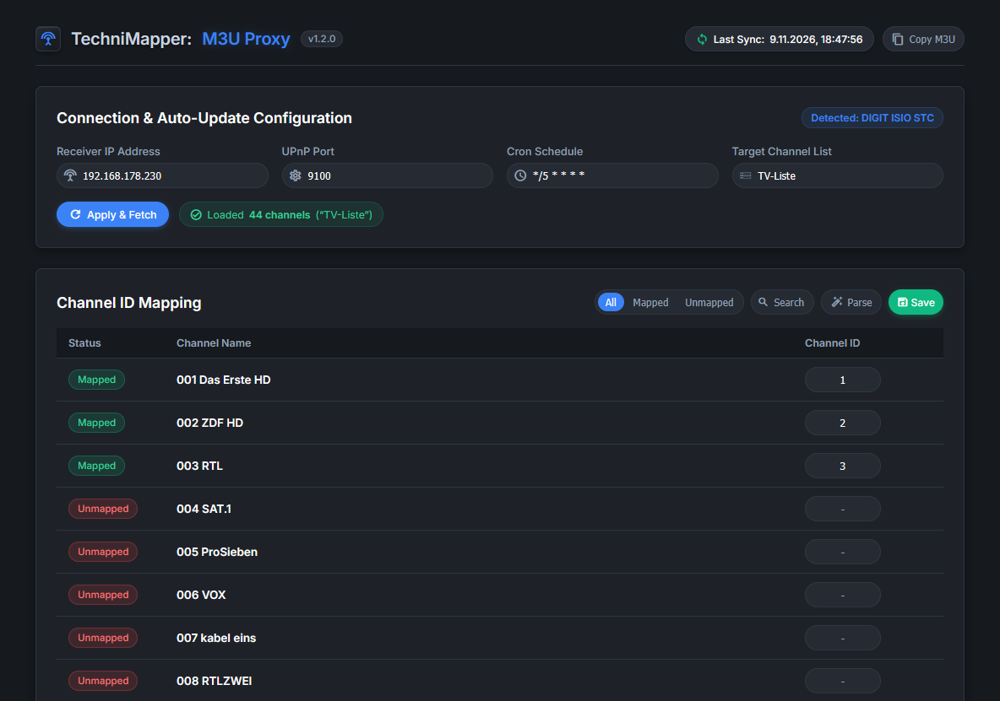
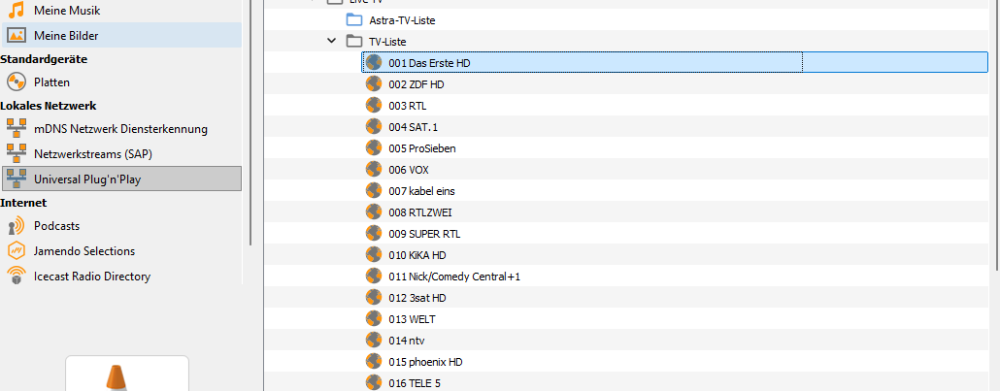
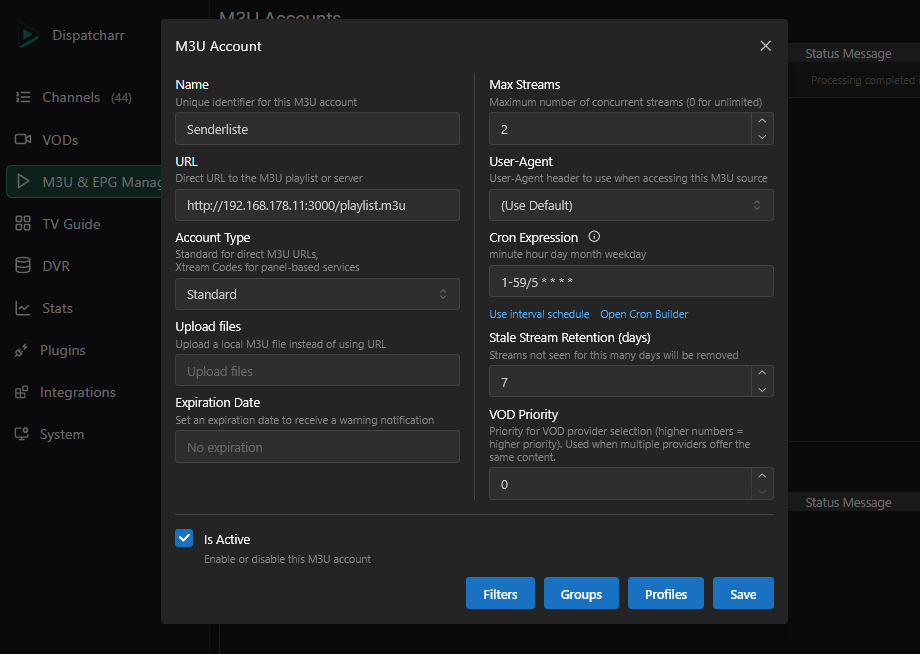
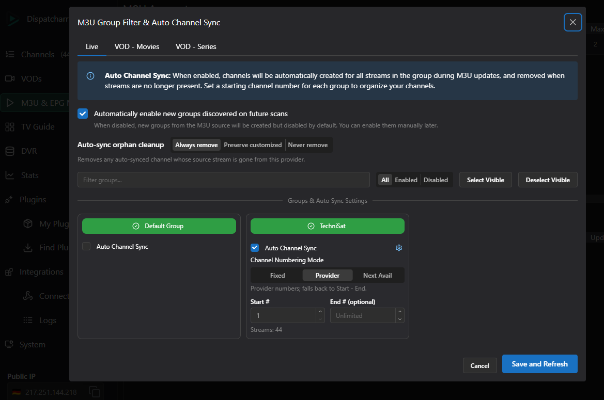
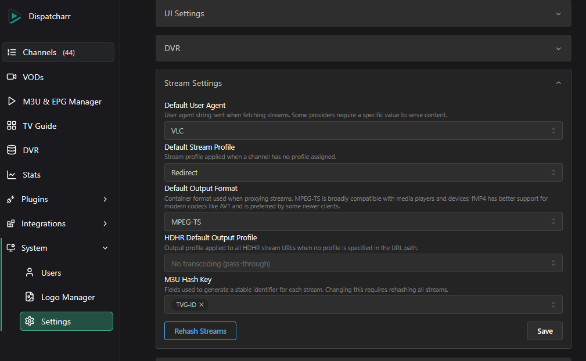

# TechniMapper: M3U Channel Mapper & M3U Proxy
A lightweight abstraction proxy that stabilizes shifting TechniSat UPnP streams into a permanent, static M3U playlist tailored exclusively for Dispatcharr.

## The Problem: Stream Instability
TechniSat receivers frequently change internal stream URLs and session parameters due to channel rescans, background updates, or reboots. Linking these raw URLs directly into IPTV tools like Dispatcharr causes constant breakage, as the streams become dead ends as soon as the receiver refreshes its internal state.

## The Solution: TechniMapper
TechniMapper acts as an abstraction layer to ensure your configuration remains stable:

* **Dynamic Synchronization:** A background cron engine crawls the receiver’s shifting UPnP structure to fetch the latest, valid stream URLs.
* **Static Mapping:** Maps volatile URLs to permanent, custom Channel IDs defined via the Web UI.
* **Automated List Fetching:** Selecting a different target channel list automatically triggers an immediate *Apply & Fetch* cycle.
* **Smart Parsing:** One-click extraction automatically parses channel numbers from stream names.
* **One-Click Copy & Toast Notifications:** Copy the live `/playlist.m3u` proxy URL to your clipboard with clean UI feedback.
* **Persistent, Safe Playlist:** Provides a consistent M3U endpoint. If the receiver is unreachable (e.g. in standby), the **last known good playlist** keeps being served. While nothing is synced or mapped yet, the endpoint answers `503` instead of an empty list, so Dispatcharr never purges your channels by accident.
* **Built-in Safeguards:** Strict input validation, optional Basic Auth, health endpoint, non-root container, signed multi-arch images.

## Compatibility Note
TechniMapper is specifically developed and tested for the TechniSat DIGIT ISIO STC.

✅ **Supported:** DIGIT ISIO S / S1 / S2, DIGIT ISIO STC

❌ **Not Supported:** DIGIPLUS UHD S2, DIGIT ISIO S3, and newer

*Note: Models not listed as supported may use different SOAP service structures which are not currently implemented.*

## Targeted Integration
This tool is **specifically built and optimized to be utilized exclusively in tandem with Dispatcharr**. It serves as the dedicated translation bridge, eliminating formatting mismatches and URL instability natively, feeding your TechniSat tuner streams reliably into your automated **Dispatcharr** pipeline.



## Prerequisites

⚠️ **Crucial Step:** Before running this tool, you **must have a valid, fully configured TV channel list** set up directly on your receiver (specifically tested on the *TechniSat DIGIT ISIO STC*). If no internal channel list exists on the hardware, the UPnP directory tree will remain empty, and the mapper won't be able to discover any streams.

The receiver must be reachable from the container via a **private IPv4 address** (10.x, 172.16–31.x, 192.168.x). For VPN/CGNAT setups set `ALLOW_NON_PRIVATE_IP=true`.



## Quick Start & Deployment

The container runs as the unprivileged user `node` (**UID 1000**). A bind-mounted data directory must therefore be writable for that user:

```bash
mkdir -p data && chown -R 1000:1000 data
```

Without this step the container exits at startup with *"Data directory ... is not writable"*.

### Option A: Docker Compose (Recommended)

```yaml
services:
  technimapper-m3u-proxy:
    image: ghcr.io/danielfranze/technimapper-m3u-proxy:1.5.0   # pin a version, avoid :latest in production
    container_name: technimapper-m3u-proxy
    ports:
      - "3000:3000"
    volumes:
      - ./data:/app/data
      - /etc/localtime:/etc/localtime:ro
    environment:
      - TZ=Europe/Berlin
      # - ADMIN_USER=admin
      # - ADMIN_PASSWORD=change-me
    read_only: true
    tmpfs:
      - /tmp
    cap_drop:
      - ALL
    security_opt:
      - no-new-privileges:true
    restart: unless-stopped
```

The repository also ships a ready-to-use `docker-compose.yml` (builds locally with `build: .`).

### Option B: Portainer Stack
1. Open your **Portainer** dashboard → **Stacks** → **Add stack**.
2. Give it a name (e.g., `technimapper-m3u-proxy`).
3. Select the **Web editor** and paste the Compose snippet from Option A.
4. Use an **absolute host path** or a **named volume** for the data directory (relative paths such as `./data` are unreliable in Portainer). With a named volume (`technimapper-data:/app/data`) no `chown` is needed.

### Option C: Docker CLI
```bash
docker run -d \
  -p 3000:3000 \
  --name technimapper-m3u-proxy \
  -v technimapper-data:/app/data \
  -v /etc/localtime:/etc/localtime:ro \
  -e TZ=Europe/Berlin \
  --restart unless-stopped \
  ghcr.io/danielfranze/technimapper-m3u-proxy:1.5.0
```

### Upgrading from 1.3.x or older
1. Stop the container.
2. If you used a **single-file mount** (`./mapping.json:/app/data/mapping.json`), move the file into a directory: `mkdir -p data && mv mapping.json data/`.
3. `chown -R 1000:1000 data`
4. Switch the volume to `./data:/app/data` and start the new version.
5. Check the logs: invalid persisted values (e.g. a broken cron expression) are repaired automatically and reported as warnings.

Read the [CHANGELOG](CHANGELOG.md) for all breaking changes.

## Configuration

Everything related to the receiver (IP, port, cron schedule, channel list, mapping) is configured in the Web UI at `http://<YOUR-SERVER-IP>:3000`. Runtime behavior is controlled via environment variables:

| Variable | Default | Description |
|---|---|---|
| `PORT` | `3000` | HTTP port inside the container. |
| `DATA_DIR` | `/app/data` | Directory for `mapping.json`. Must be writable. |
| `REQUEST_TIMEOUT_MS` | `5000` | Idle timeout per UPnP request (hard deadline: 3×). |
| `ALLOW_NON_PRIVATE_IP` | `false` | Allow receiver IPs outside RFC1918 (VPN/CGNAT). Loopback and link-local stay blocked. |
| `ADMIN_USER` / `ADMIN_PASSWORD` | – | Enables HTTP Basic Auth for the UI and `/api/*`. Set both. |
| `TRUST_PROXY` | – | Number of reverse-proxy hops (or `true`) so rate limiting sees real client IPs. |
| `LOG_LEVEL` | `info` | `error`, `warn` or `info`. |
| `LOG_FORMAT` | `text` | `text` or `json` (one JSON object per line, for log collectors). |
| `TZ` | – | Time zone of the container. |

### HTTP endpoints

| Endpoint | Auth | Description |
|---|---|---|
| `GET /playlist.m3u` | public | The M3U playlist. `503` + `Retry-After` while nothing is synced/mapped. |
| `GET /health` | public | Liveness/status JSON (`ok` or `degraded`, last sync, last error). |
| `GET /api/get-config` | Basic Auth¹ | Current settings, version, last sync, last error. |
| `POST /api/fetch-channels` | Basic Auth¹ | Applies settings and syncs with the receiver. |
| `POST /api/save-mapping` | Basic Auth¹ | Saves the channel-name → ID mapping. |
| `GET /api/export-config` / `POST /api/import-config` | Basic Auth¹ | Backup and restore of settings and mapping. |

¹ Only enforced if `ADMIN_USER` and `ADMIN_PASSWORD` are set.

## Security

* TechniMapper is built for **trusted home/office networks**. **Do not expose it directly to the internet.**
* Set `ADMIN_USER`/`ADMIN_PASSWORD` and run it behind a TLS-terminating reverse proxy (set `TRUST_PROXY`). Basic Auth over plain HTTP is not encrypted.
* The web UI is self-contained: fonts and icons are bundled (`public/fonts/`), the browser makes no requests to external hosts.
* `/playlist.m3u` is public on purpose (Dispatcharr, container health checks) and contains your receiver's stream URLs.
* Report vulnerabilities as described in [SECURITY.md](SECURITY.md).

### Supply chain
Release images are multi-arch (`linux/amd64`, `linux/arm64`), include an SBOM and provenance attestation, and are signed with [cosign](https://github.com/sigstore/cosign) (keyless). Verify before deploying:

```bash
cosign verify ghcr.io/danielfranze/technimapper-m3u-proxy:1.5.0 \
  --certificate-identity-regexp 'https://github.com/danielfranze/technimapper-m3u-proxy/\.github/workflows/release\.yml@.*' \
  --certificate-oidc-issuer https://token.actions.githubusercontent.com
```

## Dispatcharr Configuration

### 1. M3U Account Settings
Add a new M3U account in Dispatcharr using the playlist URL provided by your Mapper instance.

* **URL:** `http://<YOUR-SERVER-IP>:3000/playlist.m3u`
* **Account Type:** Standard
* **Cron Expression:** A setting of `*/5 * * * *` is suggested to ensure regular checks for updates while maintaining receiver performance.



#### 1.1 M3U Group & Auto-Sync Settings
To fully automate your channel management, configure the Group settings within your M3U account. This ensures that Dispatcharr automatically adopts any channel changes detected by the Mapper.

* **Auto Channel Sync:** Enable this for the "TechniSat" group. This allows Dispatcharr to automatically create or remove channels based on the current M3U list.
* **Channel Numbering Mode:** Set this to *Provider*. Since the Mapper provides the `tvg-chno` attribute, Dispatcharr will automatically respect the channel numbering defined on your TechniSat receiver.
* **Auto-sync orphan cleanup:** The *Always remove* setting is recommended to maintain a clean channel list by automatically purging streams that are no longer available on the receiver (e.g., following a channel rescan). TechniMapper never serves an empty playlist, so a temporarily unreachable receiver or an unmapped installation cannot trigger a mass deletion.



### 2. Stream Settings
For best compatibility with TechniSat streams, configure your system-wide stream settings as follows:

* **Default User Agent:** Set to `VLC`. This often helps with handshake issues on older receiver firmware.
* **Default Stream Profile:** Use `Redirect`. This allows the receiver to push the stream directly to your player/client.
* **Default Output Format:** `MPEG-TS` is the native format for DVB streams and provides the highest compatibility.
* **M3U Hash Key:** Set this to `TVG-ID`. This ensures that Dispatcharr correctly tracks your channels based on the static IDs you defined in the Mapper UI.



### ℹ️ Pro-Tip:
*Note: To keep your setup perfectly synchronized and prevent any "dead links," align your cron schedules to ensure the Mapper has updated data before Dispatcharr requests it:*

* **TechniMapper Cron:** Set this to `*/5 * * * *` (every 5 minutes). This ensures the Mapper proactively fetches fresh stream URLs from your receiver and updates the playlist.
* **Dispatcharr Cron:** Set this to `1-59/5 * * * *` (every 5 minutes, starting 1 minute past). This slight offset ensures that Dispatcharr always pulls the "freshly baked" playlist from your Mapper.

By following this 5-minute sync cycle with a 1-minute offset, your Dispatcharr will always have the most current and valid stream URLs available.

## Troubleshooting

| Symptom | Likely cause / fix |
|---|---|
| Container exits: *Data directory ... is not writable* | `chown -R 1000:1000 ./data` (or use a named volume). |
| `/playlist.m3u` returns `503` | No sync yet, or no channel has an ID. Click **Apply & Fetch**, then map channels and **Save**. |
| *No TechniSat Live-TV containers found* | Wrong IP/port, receiver in standby/off, unsupported model, or no channel list configured on the receiver. |
| *Invalid receiver IP* | Only private IPv4 addresses are allowed. Use `ALLOW_NON_PRIVATE_IP=true` for VPN/CGNAT. |
| *Invalid channel ID for ...* | IDs may only contain letters, digits, `_`, `-`, `.` (max. 32 characters). |
| Status `degraded` in `/health` | Three or more consecutive failed syncs, or no playlist available. See `lastError` in `/health` or the UI tooltip on the sync badge. |

## Development

```bash
npm ci
npm test          # unit tests (Node's built-in test runner)
npm run check     # syntax check
npm start         # http://localhost:3000
```

* `server.js` – HTTP API, scheduler and receiver sync
* `lib/validation.js` – input validation (settings, mapping)
* `lib/m3u.js` – playlist generation and sanitizing
* `test/` – unit tests
* `public/index.html` – Web UI
* `public/fonts/` – bundled fonts (Inter, Material Icons Outlined), see `NOTICE.md`

CI (GitHub Actions) runs tests, `npm audit`, a Trivy image scan and a container smoke test on every push and pull request. Pushing a tag `vX.Y.Z` (matching `package.json`) builds, publishes and signs the release image and creates the GitHub release from the matching `CHANGELOG.md` section (`## [X.Y.Z]`). The tag fails fast if the version or the changelog entry is missing; tags containing a `-` (e.g. `v1.6.0-rc1`) become pre-releases and do not move the `latest` image tag.

## Third-party fonts

Inter and Material Icons (Outlined) are bundled in `public/fonts/` together with their unmodified license texts (SIL Open Font License 1.1), see [NOTICE](public/fonts/NOTICE.md).

## License

This project is open-source software licensed under the [MIT License](LICENSE). Feel free to use, modify, and distribute it.
